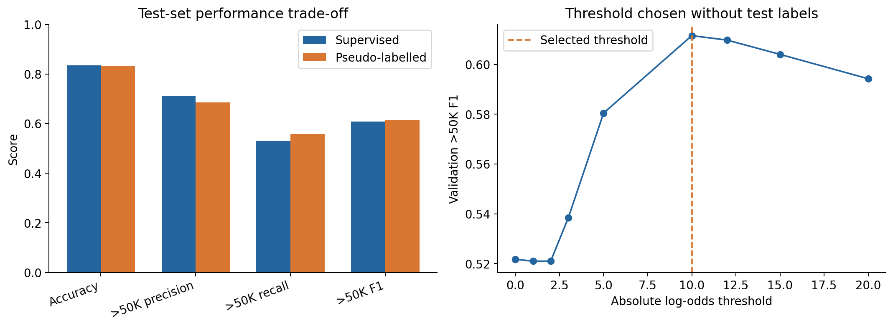
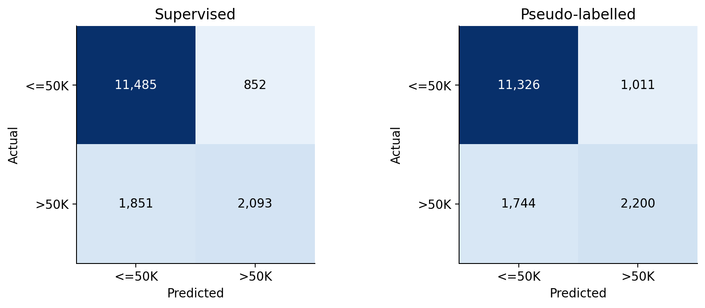

# Adult Income Classification with Confidence-Based Pseudo-Labelling

## 中文概览

### 收入分类与半监督学习

基于 Adult Income 数据，使用混合朴素贝叶斯预测收入类别，并通过高置信度伪标签利用未标注样本，比较少数类别识别能力与总体准确率之间的取舍。

- **个人工作**：原个人课程项目中实现连续与类别特征的联合分类、置信度分析、伪标签筛选及模型比较，并撰写报告。
- **主要方法**：GaussianNB 与 CategoricalNB 结合；在分层验证集上选择伪标签阈值，再使用完整训练集重建最终模型。
- **修正后结果**：高收入类别的召回率从 **53.07% 提升到 55.78%**，F1 从 **0.6076 提升到 0.6150**；总体准确率从 **83.40% 略降到 83.08%**。
- **成果展示**：提供可运行代码、已执行的实验 notebook、验证曲线、混淆矩阵及[原课程报告](reports/historical-coursework-report.pdf)。

整理版修正了验证集信息泄漏、类别先验重复计算和缺失值填补问题。原报告保留课程提交时的结果，当前比较以本仓库的重跑结果为准。

## English documentation

Compare a mixed Gaussian/categorical Naive Bayes classifier with one round of confidence-based pseudo-labelling on an imbalanced binary income task. The method is self-training-style pseudo-labelling, rather than graph-based label propagation.

### Recomputed results

All metrics below are from the reviewed run on 16,281 supplied test observations. The positive class is `>50K`.

| Method | Accuracy | Positive precision | Positive recall | Positive F1 | Macro F1 |
| --- | ---: | ---: | ---: | ---: | ---: |
| Supervised mixed NB | 83.40% | 71.07% | 53.07% | 0.6076 | 0.7512 |
| Confidence pseudo-labels | 83.08% | 68.51% | 55.78% | 0.6150 | 0.7533 |

The second model recovers more positive cases while introducing additional false positives. This modest F1 gain on one split does not establish statistical significance or general superiority.





### Experiment design

The labelled source contains 16,280 rows; complete-case filtering retains 15,076. The unlabelled source contains 16,281 rows; 15,059 remain after filtering. During selection, split labelled data into 12,060 training and 3,016 validation rows (stratified, seed 42).

Fit medians, categorical vocabulary and the pseudo-label teacher only on the training partition. Select the absolute log-odds threshold from `[0,1,2,3,5,10,12,15,20]` using positive-class validation F1. The selected threshold is **10**. After selection, refit on the full labelled training set and regenerate pseudo-labels; **4,742** unlabelled observations enter the final combined model. The validation search uses 4,640 pseudo-labels at this threshold because its teacher is trained on the smaller partition. Test rows are retained, with continuous missing values filled from training medians and unknown categorical values mapped to reserved slots.

The supplied test had already been analysed for the original coursework. This is a reviewed retrospective comparison, not a newly collected or previously unseen evaluation set. No threshold or model choice in the revised run uses test labels.

### Reproduce

Use Python 3.13 with the versions in requirements.txt. From the repository root:

```sh
python -m pip install -r requirements.txt
python src/adult_income.py --data-dir /path/to/Assignment1_data --output results
```

Required files: `adult_supervised_train.csv`, `adult_unlabelled.csv`, `adult_test.csv`. Obtain the original course split through the authorised source; raw records and the optional unlabelled-with-labels file are excluded. Input hashes are recorded in [run-record.json](results/run-record.json).

Open [reviewed_experiment.ipynb](notebooks/reviewed_experiment.ipynb) to see the executed comparison and figures. Put the three files in `data/` or set `ADULT_DATA_DIR`; `MODEL_PYTHON` can select a separate model runtime. The CLI regenerates numeric outputs, and the notebook regenerates the figures. Jupyter is an optional viewer dependency.

### Original work and review

Individual COMP30027 Machine Learning coursework, University of Melbourne, 2026, by Kunze (Charlotte) Lyu. The submitted method used the name "Label Propagation" for confidence-based pseudo-labels. Portfolio curation corrected implementation/validation issues and added the standalone runner, checks and executed comparison notebook. See [contributions](docs/CONTRIBUTIONS.md) and [review notes](docs/REVIEW.md).

The [historical report](reports/historical-coursework-report.pdf) and [historical notebook](notebooks/historical_submission.ipynb) preserve the original work and differ from the revised results. The historical notebook has cleared outputs and its identifier removed; it retains known errors for provenance and is not the recommended execution path.

Naive Bayes independence assumptions, class imbalance, complete-case selection, natural duplicate rows and sensitive demographic predictors constrain interpretation. One validation split and one-round pseudo-labelling provide a bounded experiment. No operational decision system is claimed. No new licence is assigned to course materials or supplied data.
